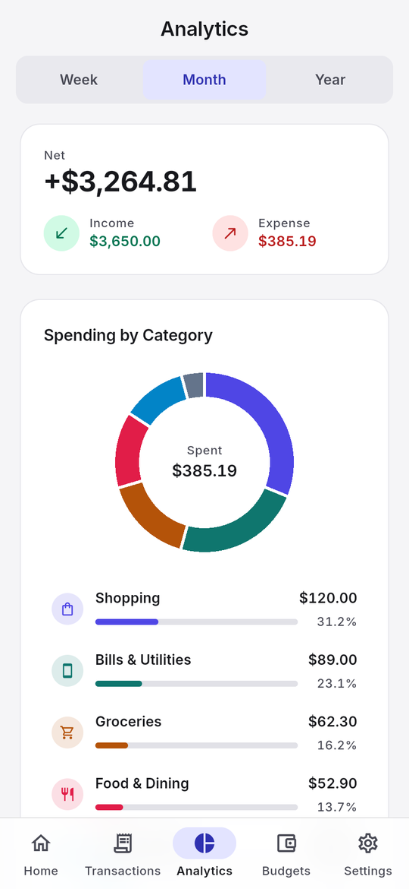
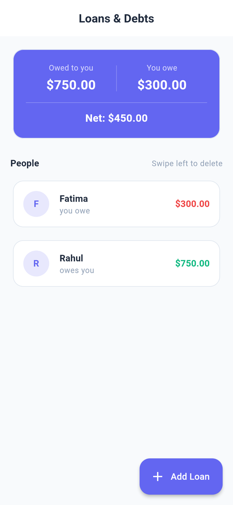

# SpendSheet

A Flutter expense tracking app for Android with Google Sheets as the backend database.

<table>
  <tr>
    <td></td>
    <td></td>
    <td></td>
    <td></td>
  </tr>
  <tr>
    <td></td>
    <td></td>
    <td></td>
    <td></td>
  </tr>
</table>

<sub>Screenshots use sample data.</sub>

## Features

- **Track Expenses & Income**: Log your daily transactions with categories
- **Google Sheets Backend**: Your data is stored in your own Google Sheets
- **Offline-First**: Works without internet, syncs when connected
- **Multiple Accounts**: Track cash, bank accounts, credit cards
- **Budget Management**: Set budgets and get alerts
- **Analytics**: Visualize spending with charts
- **Categories**: Customizable expense/income categories
- **Transfer Support**: Track money transfers between accounts
- **Google Wallet Capture** (Android, optional): Turns Google Wallet payment
  notifications into expenses you confirm with one tap

## Setting It Up for Your Own Use

SpendSheet has no server and no shared Google project. Each person who builds
it uses their own Google Cloud project, and the data goes into a spreadsheet
in their own Google Drive. Setting that up takes about 15 minutes.

### 1. What you need

- Flutter 3.50.0 or later (stable channel)
- An Android phone running Android 7.0 or later, or an emulator with Google
  Play services
- A Google account

### 2. Get the code and build it once

```bash
git clone https://github.com/aslammhdms/SpendApp.git
cd SpendApp
flutter pub get
dart run build_runner build --delete-conflicting-outputs
```

`pubspec.lock` is part of the repository, so `flutter pub get` installs the
same package versions the app was last built and tested with. To be strict
about it, use `flutter pub get --enforce-lockfile`.

The last command generates the model files (`*.freezed.dart`, `*.g.dart`).
They are not stored in the repository, so the app will not compile without
it.

### 3. Find your signing fingerprint (SHA-1)

Google only lets an Android app sign in if the app's package name and the
fingerprint of the key that signed it are registered in your Google Cloud
project. The app builds with your computer's Android debug key (the release
build uses it too, until you set up your own key), so that is the fingerprint
to register.

macOS and Linux:

```bash
keytool -list -v -keystore ~/.android/debug.keystore -alias androiddebugkey -storepass android -keypass android
```

Windows:

```bash
keytool -list -v -keystore "%USERPROFILE%\.android\debug.keystore" -alias androiddebugkey -storepass android -keypass android
```

Copy the `SHA1:` line. If the keystore file does not exist yet, run
`flutter build apk --debug` once to create it.

The fingerprint belongs to the computer, not to the project. An APK built on
another machine, or by a CI service, is signed with a different key and needs
its own fingerprint registered (step 4.5) before sign-in will work.

### 4. Set up Google Cloud

1. Open the [Google Cloud Console](https://console.cloud.google.com) and
   create a project.
2. Under **APIs & Services → Library**, enable **Google Sheets API** and
   **Google Drive API**.
3. Set up the **OAuth consent screen**: user type **External**, and fill in
   the app name and your email address.
4. On the consent screen, add the scopes `.../auth/spreadsheets` and
   `.../auth/drive.file`, and add your own Google account under **Test
   users**. While the app is in testing, only the accounts listed there can
   sign in.
5. Under **APIs & Services → Credentials**, choose **Create credentials →
   OAuth client ID** with:
   - Application type: **Android**
   - Package name: `com.spendsheet.spendsheet`
   - SHA-1 certificate fingerprint: the value from step 3

There is nothing to paste into the app. Android matches the installed app to
your project by package name and fingerprint. A new client can take a few
minutes to start working.

### 5. Install it on your phone

On the phone, turn on **Developer options → USB debugging**, connect it by
USB, and accept the "Allow USB debugging?" prompt. Then:

```bash
flutter run --release
```

Or build an APK and install it with `adb`:

```bash
flutter build apk --release
adb install -r build/app/outputs/flutter-apk/app-release.apk
```

When the app is installed, turn **USB debugging** off again: a computer the
phone trusts for debugging can reach more of the phone than you need day to
day.

Install with `adb` (or `flutter run`) rather than by opening the APK file on
the phone. Because the app can ask for notification access (for Google Wallet
capture), Google Play Protect blocks it when it is installed from a browser,
a chat app or a file manager, with the message "App blocked to protect your
device".

### 6. First run

1. Tap **Sign in with Google** and choose the account you added as a test
   user. Google will warn that the app is not verified; that is expected for
   your own project, so continue.
2. Choose **Create New SpendSheet**. The app creates the spreadsheet in your
   Google Drive. On another phone, sign in with the same account and pick
   the existing spreadsheet instead.
3. Optional: turn on **Settings → Google Wallet payments** (see
   [Google Wallet Payment Capture](#google-wallet-payment-capture)).

### If something goes wrong

| What you see | Likely cause | What to do |
| --- | --- | --- |
| "Sign in was cancelled or failed" straight after picking an account | The fingerprint or package name is not registered for the key that signed this APK | Repeat steps 3 and 4.5 on the computer that built the APK, wait a few minutes, try again |
| Google says access is blocked, or the app has not completed verification | Your account is not a test user | Add it under **Test users** on the OAuth consent screen |
| Signed in, but creating or finding the spreadsheet fails | An API is not enabled | Enable both the Sheets API and the Drive API |
| "App blocked to protect your device" | Installed by opening the APK on the phone | Install with `adb install` or `flutter run` |
| `adb devices` shows `unauthorized` | The phone has not approved this computer | Unlock the phone and accept the "Allow USB debugging?" prompt, or pair with **Wireless debugging** instead |
| `INSTALL_FAILED_UPDATE_INCOMPATIBLE` | A copy signed with a different key is already installed | Uninstall it first. Local data is removed; your spreadsheet is not |

To see the real sign-in error, try to sign in and then run
`adb logcat -d` and search the output for `ApiException`. Code `10` means the
fingerprint or package name does not match; `12501` means the sign-in was
cancelled.

### Sharing the app with other people

People who install your APK do not repeat any of this setup. They only sign
in. The Google Cloud steps are done once by whoever builds the app, for each
signing key. To let someone else use your build, add their Google account as
a test user; each person still gets their own spreadsheet in their own Drive. Opening the
app to anyone means publishing the OAuth consent screen, and Google reviews
apps that ask for access to Google Sheets before it allows that.

## Project Structure

```
lib/
├── main.dart              # App entry point
├── app.dart               # App configuration & routing
├── core/                  # Core utilities and constants
│   ├── constants/         # App-wide constants
│   ├── theme/             # Theme configuration
│   ├── utils/             # Utility functions
│   └── errors/            # Exception classes
├── data/                  # Data layer
│   ├── models/            # Data models (Freezed)
│   ├── repositories/      # Data repositories
│   ├── local/             # Local database (SQLite)
│   └── remote/            # Remote services (Google APIs)
├── features/              # Feature modules
│   ├── auth/              # Authentication
│   ├── onboarding/        # Sheet connection
│   ├── home/              # Dashboard
│   ├── transactions/      # Transaction management
│   ├── analytics/         # Charts and reports
│   ├── budgets/           # Budget management
│   ├── accounts/          # Account management
│   ├── categories/        # Category management
│   ├── wallet_capture/    # Google Wallet payment capture (Android)
│   └── settings/          # App settings
└── shared/                # Shared widgets and providers
```

## Architecture

- **State Management**: Riverpod
- **Routing**: go_router
- **Local Database**: SQLite (sqflite)
- **Remote Storage**: Google Sheets API
- **Code Generation**: Freezed + json_serializable
- **Design system**: Material 3 with tokens in `lib/core/theme` (see [docs/DESIGN.md](docs/DESIGN.md))

## Sync Architecture

The app uses an offline-first approach:

1. All writes go to local SQLite first
2. Changes are queued for sync
3. Background sync runs every 15 minutes
4. Pull-to-refresh triggers immediate sync
5. Conflicts resolved with last-write-wins

## Google Wallet Payment Capture

Optional and Android only. Turn it on in **Settings → Google Wallet
payments**, then allow notification access for SpendSheet.

1. A notification listener (`WalletNotificationListener.kt`) keeps the title
   and text of notifications posted by the Google Wallet app. Notifications
   from every other app are ignored.
2. When the app opens, the notifications are read on the device to find the
   amount, merchant and card (`WalletNotificationParser`). Nothing is sent
   anywhere.
3. Each payment waits in a review list. Confirming one creates a normal
   expense, which then syncs like any other.
4. A category is suggested for each payment. The app remembers the category
   you pick for a merchant (and the account you pick for a card), also when
   the name differs a little between branches. For a merchant it has not
   seen, it guesses from words in the name, such as "hospital",
   "supermarket" or "petrol" (`MerchantCategorizer`). You can always pick
   another.

Captured notifications stay on the device and are not written to the
spreadsheet. If you install the app from an APK instead of the Play Store,
Android 13 and later hides notification access until you choose **Allow
restricted settings** on the app's App info page.

## Building for Production

```bash
flutter build apk --release
```

Without a key of your own, the release build is signed with your computer's
debug key. That is fine for trying the app on your own phone, but do not give
such a build to other people: the debug key has a well-known password. Before
you share the app, give it its own key.

1. Create the key once. Choose your own passwords, and keep the file outside
   the project folder:

   ```bash
   keytool -genkeypair -v -keystore spendsheet-release.jks -alias spendsheet -keyalg RSA -keysize 2048 -validity 10000
   ```

2. Create the file `android/key.properties` (it is ignored by Git):

   ```properties
   storeFile=C:/Users/you/keys/spendsheet-release.jks
   storePassword=your store password
   keyAlias=spendsheet
   keyPassword=your key password
   ```

   Use forward slashes in the path, also on Windows.

3. Get the new key's SHA-1 and add it in Google Cloud: create a second
   Android OAuth client with the same package name and this fingerprint
   (step 4 above). Sign-in fails until this is done.

   ```bash
   keytool -list -v -keystore spendsheet-release.jks -alias spendsheet
   ```

4. Build as before. The build now uses your key.

Android does not let an app signed with one key replace the same app signed
with another. Uninstall the debug-signed copy from the phone once before
installing the new one; your records come back from the spreadsheet when you
sign in.

Back the keystore file and its passwords up somewhere safe. If you lose them
you cannot update the installed app; you would have to uninstall and start
again with a new key.

## License

MIT License. See [LICENSE](LICENSE).
