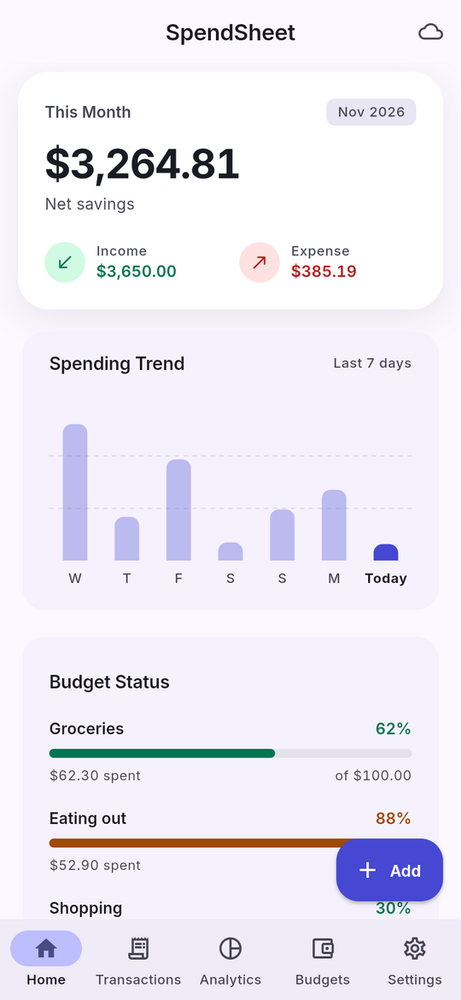
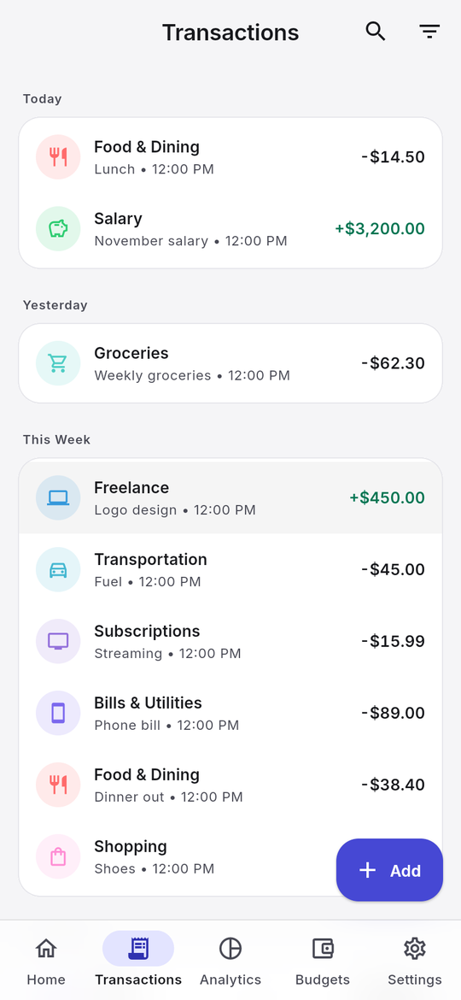
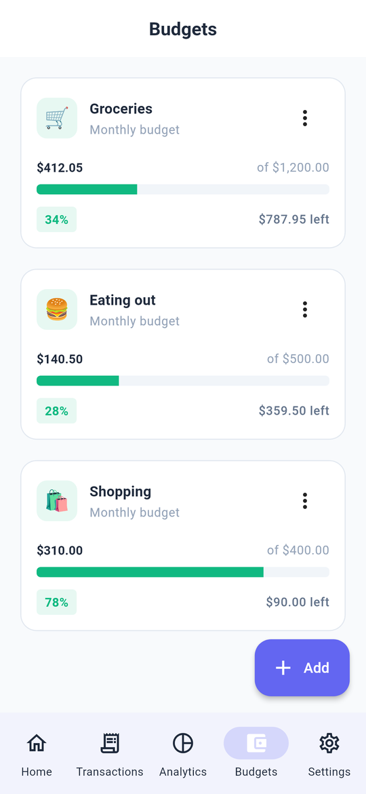
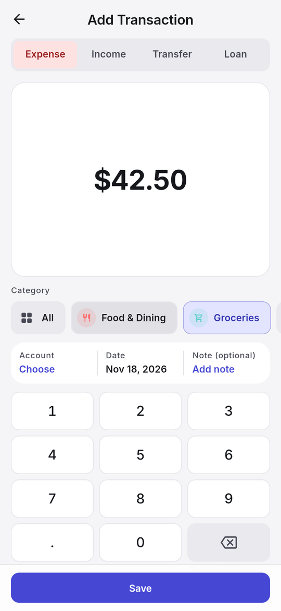
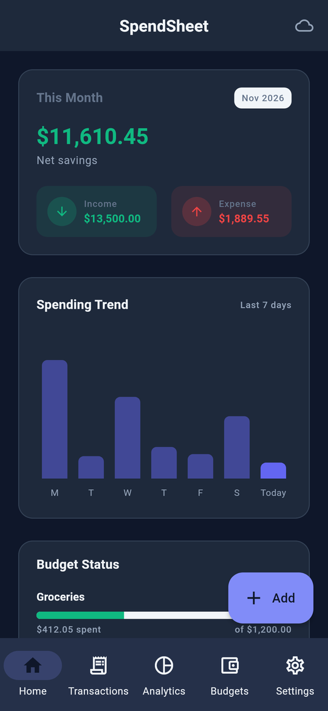
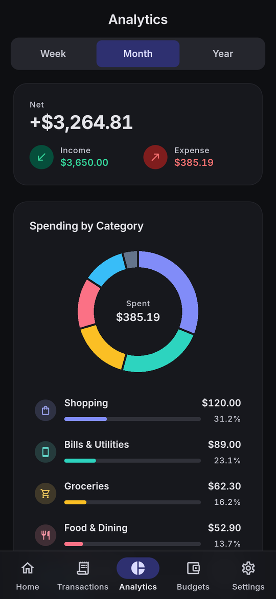

# SpendSheet

A Flutter expense tracking app for Android with Google Sheets as the backend database.

<table>
  <tr>
    <td></td>
    <td></td>
    <td></td>
    <td></td>
  </tr>
  <tr>
    <td></td>
    <td></td>
    <td></td>
    <td></td>
  </tr>
</table>

<sub>Screenshots use sample data.</sub>

## Features

- **Track Expenses & Income**: Log your daily transactions with categories
- **Google Sheets Backend**: Your data is stored in your own Google Sheets
- **Offline-First**: Works without internet, syncs when connected
- **Multiple Accounts**: Track cash, bank accounts, credit cards
- **Budget Management**: Set budgets and get alerts
- **Analytics**: Visualize spending with charts
- **Categories**: Customizable expense/income categories
- **Transfer Support**: Track money transfers between accounts

## Getting Started

### Prerequisites

- Flutter SDK 3.50.0 or higher (stable)
- Android Studio or VS Code with Flutter extensions
- A Google Cloud project with Sheets API and Drive API enabled

### Google Cloud Setup

1. Go to [Google Cloud Console](https://console.cloud.google.com)
2. Create a new project or select an existing one
3. Enable the following APIs:
   - Google Sheets API
   - Google Drive API
4. Configure OAuth consent screen:
   - Add scopes: `spreadsheets`, `drive.file`
5. Create OAuth 2.0 Client ID:
   - Application type: Android
   - Add your SHA-1 signing certificate fingerprint
   - Package name: `com.spendsheet.spendsheet`

### Installation

1. Clone this repository
2. Run `flutter pub get`
3. Run `flutter pub run build_runner build` to generate Freezed files
4. Run `flutter run`

### Configuration

Add your OAuth client ID in the Android configuration if needed.

## Project Structure

```
lib/
├── main.dart              # App entry point
├── app.dart               # App configuration & routing
├── core/                  # Core utilities and constants
│   ├── constants/         # App-wide constants
│   ├── theme/             # Theme configuration
│   ├── utils/             # Utility functions
│   └── errors/            # Exception classes
├── data/                  # Data layer
│   ├── models/            # Data models (Freezed)
│   ├── repositories/      # Data repositories
│   ├── local/             # Local database (SQLite)
│   └── remote/            # Remote services (Google APIs)
├── features/              # Feature modules
│   ├── auth/              # Authentication
│   ├── onboarding/        # Sheet connection
│   ├── home/              # Dashboard
│   ├── transactions/      # Transaction management
│   ├── analytics/         # Charts and reports
│   ├── budgets/           # Budget management
│   ├── accounts/          # Account management
│   ├── categories/        # Category management
│   └── settings/          # App settings
└── shared/                # Shared widgets and providers
```

## Architecture

- **State Management**: Riverpod
- **Routing**: go_router
- **Local Database**: SQLite (sqflite)
- **Remote Storage**: Google Sheets API
- **Code Generation**: Freezed + json_serializable

## Sync Architecture

The app uses an offline-first approach:

1. All writes go to local SQLite first
2. Changes are queued for sync
3. Background sync runs every 15 minutes
4. Pull-to-refresh triggers immediate sync
5. Conflicts resolved with last-write-wins

## Building for Production

```bash
flutter build apk --release
```

## License

MIT License. See [LICENSE](LICENSE).
